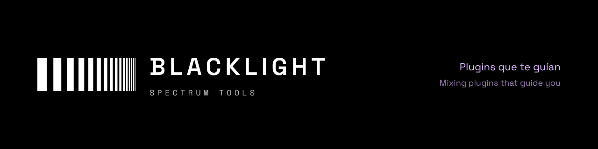

  

**Plugins que te guían.** Herramientas de mezcla gratuitas y completas que te muestran lo que están haciendo y te avisan cuando algo sale de lo normal. Para quien está aprendiendo a escuchar y para quien ya sabe, en español y en inglés.

**Mixing plugins that guide you.** Free, complete mixing tools that show you what they are doing and warn you when something is off. For people still training their ears and for people who already trust them, in Spanish and English.

### Plugins

| Plugin | Qué hace / What it does | Estado / Status |
| --- | --- | --- |
| **[Bar Spectrum Analyzer](https://github.com/blacklight-spectrum-tools/BarSpectrumAnalyzer)** | Espectro en barras con "+dB" sobre tu referencia, vista Mid/Side, fase, graves en mono y LUFS. / Spectrum in bars with "+dB" over your reference, Mid/Side view, phase, low-end mono check and LUFS. | Disponible / Available |
| Reverb | Paralelo bien resuelto y el "fantasma" del reverb en pantalla. / Proper parallel routing and an on-screen "ghost" of the reverb. | Planeado / Planned |
| Compresor guiado / Guided compressor | Zonas objetivo para threshold y make-up gain. / Target zones for threshold and make-up gain. | Planeado / Planned |
| EQ pasivo de válvulas / Passive tube EQ | | Planeado / Planned |
| Vocoder | | Planeado / Planned |

### Cómo los hacemos / How we build them

- **Guiar, no decidir.** Cada plugin mide, explica y avisa, pero las perillas las mueves tú. Así se entrena el oído.
  *Guide, don't decide. Every plugin measures, explains and warns, but you turn the knobs. That is how ears get trained.*
- **Gratis y completo.** La versión gratuita no está recortada.
  *Free and complete. The free version is not a crippled demo.*
- **Para todos los géneros**, incluidos los latinos.
  *For every genre, Latin music included.*
